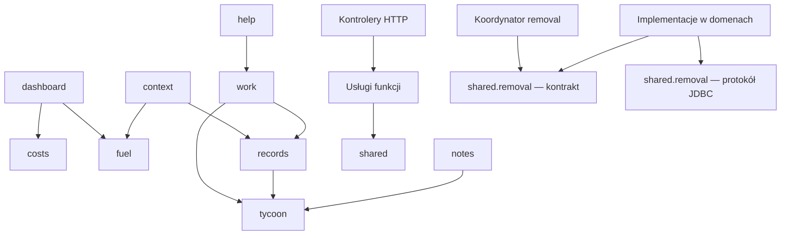

# Architektura ncLEAN CRM — zasady rozbudowy

Status: przyjęty pierwszy etap modularnego monolitu, 14.11.2026.
Decyzja dotyczy istniejącej aplikacji Java 17 / Spring Boot / Thymeleaf / PostgreSQL.
Jedna aplikacja i jedna baza; granice modułów wynikają z odpowiedzialności, nie z
mikroserwisów. Nie dokładamy osobnego frontendu ani brokera zdarzeń na zapas.

## Mapa odpowiedzialności

| Pakiet | Obecna odpowiedzialność | Kierunek dalszego wydzielania |
| --- | --- | --- |
| `calendar` | dni, obszary, plan tygodnia; repozytoria JPA | zachować osobne reguły obszarów i przypisań |
| `records` | klienci, katalog, rezerwacje, standardy i pomiary chemii | stopniowo wydzielać klientów, katalog i rezerwacje z `CrmRecords` |
| `work` | wykonanie, płatności, zamknięcie dnia, projekcje eksportu | osobne kontrakty wykonania i rozliczenia |
| `context` | wyszukiwanie, kontakt, zdjęcia i czas ze zdjęć | docelowo osobny moduł zdjęć i kontaktu; nie ogólny worek funkcji |
| `fuel` | licznik, agregat, tankowania i rachunki | osobne przechowywanie obrazów, dziennik i kalkulacje |
| `costs` | koszty, pojazd, sprzęt, historia korekt | oddzielać zapytania od poleceń; nie dublować kosztu paliwa |
| `dashboard` | agregacja i prezentacja podsumowań | wyłącznie odbiorca danych, nigdy biblioteka narzędziowa |
| `notes` | notatki, zadania i cele | zachować niezależność od kalendarza i podsumowań |
| `tycoon` | postęp i osiągnięcia, bez reguł zapisu zleceń | rozważyć zdarzenia po zatwierdzeniu transakcji dopiero gdy potrzebne |
| `help` | podpowiedzi ncLEANKA i przypomnienia | odczyt stanu, bez ukrytego zmieniania danych |
| `removal` | transakcyjny koordynator usuwania/przywracania | wyłącznie rejestr wspólnego kontraktu |
| `shared` | konwencje dat/liczb, kontrakty i techniczny protokół usuwania | brak zależności od modułów biznesowych |
| `security`, `ui` | konfiguracja bezpieczeństwa i składanie interfejsu | warstwa brzegowa aplikacji |

## Kierunek zależności

Kontroler jest adapterem HTTP: wiąże formularz, sprawdza wynik, wybiera widok lub
status. SQL, repozytoria i transakcje należą do usług. Kontroler może składać dane
kilku modułów na jednym ekranie; usługa nigdy nie wywołuje kontrolera.

Poniższy graf obejmuje najważniejsze zależności logiki. Pełna lista przed/po jest
w [dependency-evidence.json](dependency-evidence.json). Strzałka oznacza używanie
kodu drugiego modułu, nie dostęp do jego tabel.

Nie wprowadzamy zwrotnej zależności od `dashboard`. Daty i walidacja liczb są
w `BusinessDates` / `DecimalInput`. Stare metody `DashboardService` pozostają
adapterami zgodności, a nowe wywołania korzystają z `shared`. Słownik źródeł klienta
należy do `records.CustomerAcquisitionSource`; `ContextService.SOURCES/source`
pozostaje zgodny ze starymi szablonami i testami.

## Zapisy i historia

- Nowe przypadki użycia otrzymują jawne polecenia i wyniki, jak
  `CustomerProfileCommand`, `RemovalCommand`, `RemovalResult`. Nie powiększamy
  map parametrów obejmujących kilka niezależnych przypadków użycia.
- Transakcja obejmuje cały przypadek użycia. Edycja klienta i źródła pozyskania
  kończy się jednym zatwierdzeniem albo pełnym rollbackiem.
- Wersja chroni przed nadpisaniem zmian z drugiej karty. Token żądania chroni
  przed ponowieniem zapisu. CSRF i OWNER są obowiązkowe również dla AJAX.
- Historyczne ceny, zużycie i dane wizyty są snapshotami. Zmiana katalogu lub
  klienta nie przelicza ani nie przepisuje dawnych rezerwacji.
- Usunięcie jest odwracalne. Implementacja w danym module kontroluje reguły,
  np. wpłatę lub standard chemii. Koordynator nie zna tabel. Wspólny protokół
  zapewnia blokadę, wersję, rozpoznanie ponowienia i wpis do audytu w tej samej
  transakcji. Bez transakcji bezpośrednie wywołanie handlera jest odrzucane.
- Baza pozostaje wspólna. Raporty mogą czytać wiele tabel. Obecne zapisy między
  pakietami nadal wymagają dalszego rozdzielenia; sam graf Java nie gwarantuje
  własności tabel. Nowe zapisy powinny wywoływać kontrakt właściciela danych.
- Flyway V1–V15 pozostają niezmienione. Zmiana schematu dostaje kolejną migrację;
  nie używamy `ddl-auto=update`, `clean` ani ręcznego kasowania danych.

## Jak dodać funkcję

1. Ustal właściciela danych i konkretny przypadek użycia. Zacznij w istniejącym
   module; nowy pakiet domenowy ma wynikać z odpowiedzialności, nie z ekranu.
2. Wprowadź typowane polecenie/wynik i usługę z transakcją. Widok i kontroler
   korzystają z tej usługi. Nie przekazuj `HttpServletRequest` do logiki.
3. Odczyt ekranu może mieć osobny model/projekcję, jak `ExportQueries`. Nie
   wymagaj od kontrolera znajomości SQL ani typów JDBC.
4. Jeśli funkcja ma usuwanie, zarejestruj bean `RemovalHandler` we własnym module.
   Nie dopisuj `if(kind...)` do koordynatora. Sprawdź audyt i przywracanie.
5. Testuj regułę, uprawnienia, konflikt wersji, błąd i ponowienie. Zapis wymaga
   testu na PostgreSQL; sam mock nie sprawdza transakcji ani blokad.
6. Uruchom `./mvnw verify` (Windows: `.\mvnw.cmd verify`). Docker jest potrzebny
   dla Testcontainers. Nie wyciszaj błędów architektury wyjątkami dla nowej domeny.
7. Dla zmiany interfejsu sprawdź 360/390/768/1440 px, klawiaturę, zachowanie danych
   przy błędzie oraz ograniczenie animacji. Prawdziwa aplikacja jest źródłem
   prawdy; HTML demonstracyjny nie jest drugą implementacją biznesu.

## Etapy następne — bez przepisywania wszystkiego

1. Rozdzielić `CrmRecords` na API klienta, katalogu i rezerwacji za zachowaną fasadą.
   Przenosić po jednym przypadku użycia z testami kontraktu i snapshotów.
2. Mapować wyjątki aplikacyjne na HTTP w adapterach; stopniowo usuwać
   `ResponseStatusException` z istniejących usług. Typować projekcje `Map<String,Object>` przy zmienianych ekranach; wydzielać
   zapytania/repozytoria z usług bez sztucznej warstwy dla każdego prostego SELECT.
3. Oddzielić zdjęcia od `context` i `ReceiptService`, z zachowaniem autoryzowanego
   odczytu oraz historii czasu. Ustalić właściciela zapisów do tabeli `booking`.
4. Podzielić `CalendarPostgresIT` na zestawy tematyczne ze wspólnym narzędziem
   uruchomienia PostgreSQL/HTTP. Zachować scenariusze przekrojowe i restart.
5. Ujednolicić JS: jeden klient HTTP z CSRF, obsługa błędu, tokeny i wspólny
   mechanizm bazowej ścieżki. Funkcje ekranów mają własny stan, bez logiki w HTML.
6. Uporządkować formatowanie dotykanych klas. Bez masowego formatowania razem
   ze zmianą reguł, które utrudniałoby weryfikację zachowania.

Dostosowanie do `https://nclean.pl/crm/` jest osobnym, nadal otwartym etapem:
ścieżki, cookies, zasoby i scope/cache PWA muszą być izolowane od głównej strony.
Patrz [audyt wdrożenia](../../deploy/SAME-DOMAIN-AUDIT.md). Testy na ścieżce `/`
nie potwierdzają gotowości pod `/crm`.
